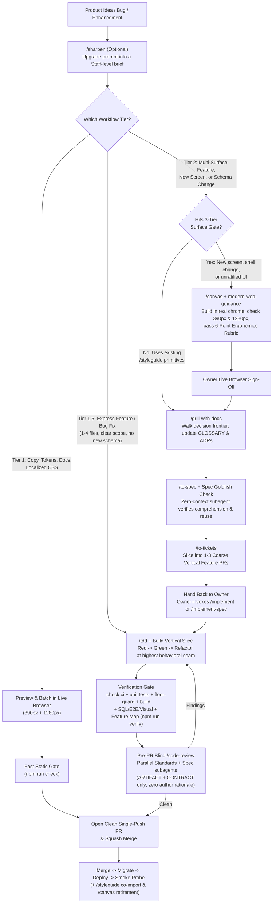

# AI Engineering Operating System & Workflows

**A universal, high-trust agentic software engineering and UX design operating system built for Product & Strategy Directors, technical founders, and lean teams.**

This repository is the single source of truth for our global agent rules (`rules/`), 34 curated engineering and design skills (`skills/`), architectural playbooks (`docs/`), multi-device sync scripts (`scripts/`), and monthly CTO workflow reviews (`reviews/`).

---

## Why This Exists

Most AI coding setups assume a senior software engineer is reading every line of generated code to catch architectural drift, legacy workarounds, silent test skips, and subtle race conditions.

When the project owner is a **Product & Strategy Director**—or a fast-moving team shipping at high velocity—line-by-line human code review does not scale. Instead of relying on agent promises in prose, this operating system combines the best ideas from four industry-leading ecosystems into one cohesive loop:

1. **Matt Pocock (`skills`) — Human-in-the-Loop Grilling & Coarse Vertical Slicing:** Interrogating the design tree upfront (`/grill-with-docs`), locking domain vocabulary (`GLOSSARY.md` + ADRs), and slicing specs into **1–3 coarse vertical feature PRs** (`/to-spec` → `/to-tickets`).
2. **Lauren Tan / `@poteto` (`pstack`) — Scientific Execution & Runtime Proof:** Turning rough ideas into Staff-level briefs (`/sharpen`), enforcing *Attack the Premise* and *Explain the Number*, verifying every user-facing capability against a live Feature Map (`npm run verify`), and systematically converting repeated prose corrections into mechanical code checks (`/correct`).
3. **Addy Osmani (`agent-skills` & `web-quality-skills`) — Anti-Cheating Guardrails & Blind Adversarial Review:** Blocking agents from silently lowering the quality bar (`floor-guard` against `@ts-ignore`, `biome-ignore`, `.skip`, or deleted assertions), stripping author excuses from code review (**Blind Contract Review**), and running live Lighthouse/DevTools/OWASP audits (`web-quality-audit`, `security-and-hardening`).
4. **Google Chrome (`modern-web-guidance`) — Baseline Web Platform Standards:** Injecting current cross-browser HTML, CSS, and DOM standards into `/canvas` prototyping so agents build with modern native APIs instead of legacy 2021 JavaScript workarounds.

---

## Onboarding Any Project (For Humans & AI Agents)

If you (or an AI agent) are pointed at this repository to adopt this workflow on a machine or project, follow this exact two-step protocol:

### Step 1: Install Global Skills & Rules on the Machine
Clone this repository and run the sync script ([see Multi-Device Setup & Sync below](#multi-device-setup--sync)) so the agent harness has all 34 skills in `skills/` and the global guidelines in `rules/GEMINI.md`.

### Step 2: Incorporate Into the Target Project (`project-init` vs. `project-adopt`)
* **Brand-New / Empty Repository:** Invoke [`/project-init`](skills/project-init/SKILL.md). It walks the project through [`checklist.md`](skills/project-init/checklist.md) and scaffolds `AGENTS.md` from [`rules/AGENTS-TEMPLATE.md`](rules/AGENTS-TEMPLATE.md), adapting gate commands to the chosen tech stack.
* **Existing Repository (Even Freshly Scaffolded):** Invoke [`/project-adopt`](skills/project-adopt/SKILL.md). It audits the repository against [`checklist.md`](skills/project-init/checklist.md) and performs a **surgical merge** governed by the **Override vs. Preserve Precedence Law**:

| Category | Precedence Rule | Concrete Examples |
|---|---|---|
| **1. Workflow, Verification & Quality Mechanics** | **OVERRIDE** conflicting or weaker project processes with this Operating System | Replaces direct-to-`main` commits, post-PR code reviews, untested code, 10-ticket micro-slicing, unratified in-place UI edits, `@ts-ignore`/`.skip` suppressions, and multi-VM CI billing traps with our **Tier 1 / 1.5 / 2 workflow**, **3-Tier `/canvas` Surface Gate**, **TDD**, **Floor Guard**, **Feature-Map Verification**, and **Pre-PR Blind Adversarial `/code-review`**. |
| **2. Project-Specific Identity, Stack, Domain & Rules** | **PRESERVE 100%** of the existing project's domain, stack, design, and custom rules | **Never** overwrites or deletes the project's tech stack/tooling (`package.json`, `pyproject.toml`, `Cargo.toml`), domain glossary (`GLOSSARY.md`), existing ADRs (`docs/adr/`), database/RLS architecture, brand design tokens (`DESIGN.md`, `tokens.css`), or project-specific business/security rules in `AGENTS.md` / `CLAUDE.md`. |

---

## Master End-to-End Lifecycle



---

## Repository Structure

```text
workflows/
├── README.md                                  # System overview, master diagram, skill catalog & sync guide
├── docs/
│   ├── philosophy-and-trust-pyramid.md        # The 5-Layer Trust Pyramid, Role Division & Blind Contract Review
│   ├── workflow-tiers-and-surface-gate.md     # Proportional Tiers (1 / 1.5 / 2), Coarse Slicing & /canvas Gate
│   └── model-routing-and-ci-economics.md      # Vendor-neutral 3-tier model routing & $0 CI quota engineering
├── rules/
│   ├── GEMINI.md                              # Global Agent Guidelines (~/.gemini/GEMINI.md)
│   └── AGENTS-TEMPLATE.md                     # Universal project-level AGENTS.md template
├── skills/                                    # 34 portable SKILL.md packages (works across major harnesses)
├── reviews/
│   └── 2026-11-18-monthly-checkpoint.md       # November 2026 CTO Workflow & CI Quota Review
└── scripts/
    ├── sync.ps1                               # 1-command Windows PowerShell sync (-Pull / -Push)
    └── sync.sh                                # 1-command macOS / Linux Bash sync (--pull / --push)
```

---

## Deep-Dive Documentation

1. **[Philosophy & The Trust Pyramid](docs/philosophy-and-trust-pyramid.md)** — How a non-coder Product Director guarantees world-class engineering quality through mechanical gates, Blind Contract adversarial review, and `/correct`.
2. **[Workflow Tiers & The 3-Tier Surface Gate](docs/workflow-tiers-and-surface-gate.md)** — Detailed playbooks and Mermaid diagrams for Tier 1, Tier 1.5, Tier 2, coarse vertical slicing, and the `/canvas` → Production → `/styleguide` pipeline.
3. **[Vendor-Neutral Model Routing & CI Economics](docs/model-routing-and-ci-economics.md)** — How to route across Fast Scout, Daily-Driver Workhorse (>90%), and Frontier Reasoning (<10%) models across Gemini, Claude, OpenAI, and OpenRouter—plus how to cut GitHub Actions billed minutes by ~65% at \$0 cost.
4. **[Monthly CTO Reviews (`reviews/`)](reviews/2026-11-18-monthly-checkpoint.md)** — Empirical audits of workflow changes, upstream skill releases, and CI telemetry.

---

## Complete Catalog of Included Skills (34 Skills)

### 1. Define, Sharpen & UX Prototype
| Skill | Source | When to Use |
|---|---|---|
| [`sharpen`](skills/sharpen/SKILL.md) | `pstack` | Rewrite a rough prompt into a deep Staff-level brief before planning or grilling. |
| [`grill-me`](skills/grill-me/SKILL.md) | `mattpocock` | Stress-test an idea or plan one decision frontier at a time with recommended answers. |
| [`grill-with-docs`](skills/grill-with-docs/SKILL.md) | `mattpocock` | Grill a feature while reading and updating `GLOSSARY.md` and ADRs inline. |
| [`grilling`](skills/grilling/SKILL.md) | `mattpocock` | Core interrogation engine used by `grill-me`, `grill-with-docs`, and `triage`. |
| [`canvas`](skills/canvas/SKILL.md) | Custom OS | Prototype new screens or shell changes inside real site chrome at `390px` & `1280px`. |
| [`modern-web-guidance`](skills/modern-web-guidance/SKILL.md) | Google Chrome | Retrieve modern Baseline HTML/CSS/DOM patterns before building new UI primitives. |
| [`prototype`](skills/prototype/SKILL.md) | `mattpocock` | Build a fast throwaway logic or UI prototype to settle an empirical design fork. |
| [`design-system`](skills/design-system/SKILL.md) | Custom OS | Define, document, or audit semantic design tokens, typography, and component states. |

### 2. Spec, Domain Model & Slice
| Skill | Source | When to Use |
|---|---|---|
| [`domain-modeling`](skills/domain-modeling/SKILL.md) | `mattpocock` | Build and sharpen `GLOSSARY.md` and record Architecture Decision Records (ADRs). |
| [`to-spec`](skills/to-spec/SKILL.md) | `mattpocock` | Crystallize a grilled design into a durable spec issue (with Spec Goldfish check). |
| [`to-tickets`](skills/to-tickets/SKILL.md) | `mattpocock` | Break a spec into **1–3 coarse vertical feature tickets** with blocking edges. |
| [`wayfinder`](skills/wayfinder/SKILL.md) | `mattpocock` | Chart and navigate multi-session exploratory projects with fog-of-war maps. |
| [`research`](skills/research/SKILL.md) | `mattpocock` | Investigate questions against primary sources in a fresh-context background subagent. |

### 3. Build, Refactor & Debug
| Skill | Source | When to Use |
|---|---|---|
| [`implement`](skills/implement/SKILL.md) | `mattpocock` | Implement a single ticket test-first (`tdd`), verify gates, and open a PR. |
| [`implement-spec`](skills/implement-spec/SKILL.md) | `mattpocock` | Orchestrate fresh implementer subagents across a spec's dependency frontier. |
| [`tdd`](skills/tdd/SKILL.md) | `mattpocock` | Red → Green → Refactor test-driven development at the highest behavioral seam. |
| [`codebase-design`](skills/codebase-design/SKILL.md) | `mattpocock` | Design deep modules with simple interfaces and design-it-twice comparisons. |
| [`improve-codebase-architecture`](skills/improve-codebase-architecture/SKILL.md) | `mattpocock` | Walk a codebase organically to find shallow module seams and deepening candidates. |
| [`diagnosing-bugs`](skills/diagnosing-bugs/SKILL.md) | `mattpocock` + `pstack` | Build a tight red feedback loop, reproduce, minimize, test falsifiable hypotheses, and fix. |
| [`triage`](skills/triage/SKILL.md) | `mattpocock` | Verify bug reports by reproduction, categorize issues, and write agent-ready briefs. |

### 4. Verify, Review & Audit
| Skill | Source | When to Use |
|---|---|---|
| [`code-review`](skills/code-review/SKILL.md) | `mattpocock` + Osmani | Pre-PR two-axis (**Standards** + **Spec**) Blind Adversarial review with Floor Guard check. |
| [`web-quality-audit`](skills/web-quality-audit/SKILL.md) | Addy Osmani | Live Lighthouse, DevTools Performance Insights, Core Web Vitals, WCAG 2.2 AA & SEO audit. |
| [`security-and-hardening`](skills/security-and-hardening/SKILL.md) | Addy Osmani | STRIDE threat modeling, OWASP Top 10, RLS/auth boundary hardening, and Floor Guard reference. |
| [`correct`](skills/correct/SKILL.md) | `pstack` | Mine repeated agent mistakes and turn prose rules into architecture, types, or wiring tests. |

### 5. Project Operating System & Meta
| Skill | Source | When to Use |
|---|---|---|
| [`project-init`](skills/project-init/SKILL.md) | Custom OS | Walk a brand-new repository through the full operating-system checklist (`checklist.md`). |
| [`project-adopt`](skills/project-adopt/SKILL.md) | Custom OS | Audit an existing repository against `checklist.md` and emit scored remediation tickets. |
| [`retro`](skills/retro/SKILL.md) | `mattpocock` | Mine a completed session transcript to improve skills and checklists. |
| [`handoff`](skills/handoff/SKILL.md) | `mattpocock` | Package in-flight state as concise context pointers for the next session. |
| [`writing-for-agents`](skills/writing-for-agents/SKILL.md) | `mattpocock` | Author or refine `SKILL.md`, `AGENTS.md`, or `CLAUDE.md` files without bloat. |
| [`setup-matt-pocock-skills`](skills/setup-matt-pocock-skills/SKILL.md) | `mattpocock` | Configure issue tracker (`docs/agents/issue-tracker.md`) and triage labels in a repo. |
| [`ask-matt`](skills/ask-matt/SKILL.md) | `mattpocock` | Guided workflow coach explaining which skill fits the current phase. |
| [`wait-what`](skills/wait-what/SKILL.md) | `mattpocock` | Pause and surface assumptions when a conversation or plan feels off-track. |
| [`caveman`](skills/caveman/SKILL.md) | Custom OS | Ultra-compressed token-saving communication mode for agent-to-agent messages. |
| [`graphify`](skills/graphify/SKILL.md) | Custom OS | Build and query AST + conceptual knowledge graphs across large repositories. |

---

## Multi-Device Setup & Sync

Clone this repository once into `~/.gemini/workflows` (or any directory) and run the sync script to install or update all 34 skills and global rules.

### Windows (PowerShell)
```powershell
# First-time clone
git clone https://github.com/Justin-Fyk/workflows.git "$HOME\.gemini\workflows"

# Pull latest changes from GitHub and install to ~/.gemini/config/skills & ~/.gemini/GEMINI.md
& "$HOME\.gemini\workflows\scripts\sync.ps1" -Pull

# Copy local skill/rule edits back into the repo to commit & push
& "$HOME\.gemini\workflows\scripts\sync.ps1" -Push
```

### macOS / Linux (Bash / Zsh)
```bash
# First-time clone
git clone https://github.com/Justin-Fyk/workflows.git ~/.gemini/workflows

# Pull latest changes from GitHub and install to ~/.gemini/config/skills & ~/.gemini/GEMINI.md
bash ~/.gemini/workflows/scripts/sync.sh --pull

# Copy local skill/rule edits back into the repo to commit & push
bash ~/.gemini/workflows/scripts/sync.sh --push
```

### Using With Other Agent Harnesses (Claude Code, Cursor, OpenCode, Kilo)
Because every skill in `skills/` follows the open `SKILL.md` standard and uses **100% vendor-neutral model routing**, you or your partners can also install them into any other agent tool:
* **Universal `npx skills` CLI (Claude Code, Cursor, Windsurf, Copilot, OpenCode):**
  ```bash
  npx skills add Justin-Fyk/workflows
  ```
* **Cursor / Claude Code / Kilo Manual Sync:** Pass `-TargetSkillsDir "<path>"` to `scripts/sync.ps1` (e.g., `-TargetSkillsDir "$HOME\.claude\skills"` or `".cursor\skills"`).
