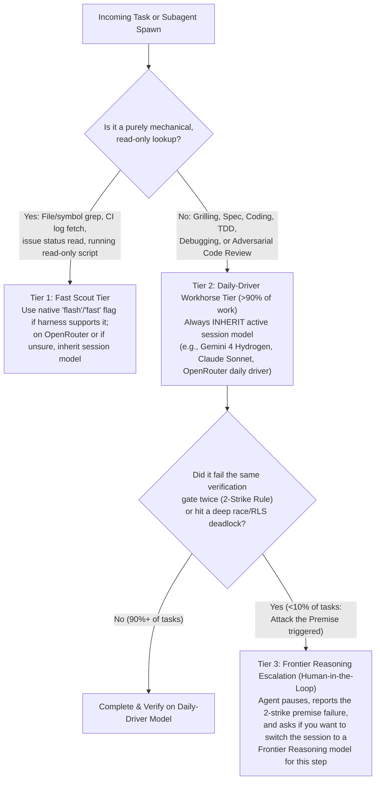

# Vendor-Neutral Model Routing & Zero-Budget CI Economics

This guide covers how we keep both **AI model token costs** and **GitHub Actions CI minutes** low without sacrificing verification rigor—and without locking the workflow to any single AI vendor.

---

## Part 1: Vendor-Neutral 3-Tier Model Routing

### Why Skills Must Never Hardcode Model Names
When working across multiple devices, partners, and agent harnesses (Google Antigravity, Claude Code, Cursor, Codex, OpenCode, Kilo + **OpenRouter**), hardcoding model slugs like `claude-opus` or `gemini-4-carbon` inside `SKILL.md` files causes three problems:
1. **OpenRouter & Cross-Provider Breakage:** A hardcoded model slug fails immediately if a partner's OpenRouter configuration or IDE uses a different provider.
2. **Unintended Spend:** A skill that silently overrides the session model to call a frontier reasoning model burns premium quota without the user's consent.
3. **Instant Obsolescence:** Every time a new model generation ships, hardcoded skill files rot.

### The Architecture Beats the Model Size
Because our workflow front-loads clarity (**Grilling → Spec → Coarse Vertical Tickets → Strict Types/Linter → Design Law → Feature-Map Verification**), the repository's rails do the heavy lifting. Inside strong rails, a fast, cost-efficient **Daily-Driver Workhorse model handles >90% of all engineering, spec writing, and code review work**.

### The 3 Capability Tiers

| Tier | Workload Share | What Runs Here | Subagent `Model` Rule | Example Models Across Providers |
|---|---|---|---|---|
| **Tier 1: Fast Scout** | Mechanical sub-tasks | Read-only file/symbol scouting, fetching CI/issue logs, running read-only verification scripts. | Use generic `"flash"` / `"fast"` tier if native to the harness; **omit (`inherit`) on OpenRouter** so it never errors. | Gemini Flash, Claude Haiku, GPT-5 Mini, Qwen/DeepSeek Fast |
| **Tier 2: Daily-Driver Workhorse** | **>90% of all work** | `/sharpen`, `/grill-with-docs`, `/to-spec`, `/to-tickets`, `/canvas`, `/tdd`, feature implementation, and `/code-review`. | **Always `inherit` the user's active session model.** Never auto-upgrade. | Gemini 4 Hydrogen, Claude Sonnet, GPT-5 Standard, Kimi / DeepSeek via OpenRouter |
| **Tier 3: Frontier Deep-Reasoning** | **<10% of work (Human-Triggered)** | Multi-layer concurrency/race conditions, complex multi-table RLS deadlocks, or 2-strike gate failures (*Attack the Premise*). | **Human-selected only.** Agent recommends switching after 2 failed gate attempts on the same premise; user decides. | Gemini 4 Carbon / Argon, Claude Opus, OpenAI o3/Pro, DeepSeek-R1 |

---

## Part 2: Zero-Budget CI & GitHub Actions Quota Engineering

Private repositories on GitHub Free (2,000 min/month) or GitHub Pro (3,000 min/month) will burn through their entire monthly quota in **12–15 days** if CI workflows are designed naively.

Below are the five structural rules required to keep a full production pipeline (Typecheck + Lint + Unit Tests + Production Build + Database SQL Invariants + Playwright E2E + Auto-Deploy) under **~1,400 billed minutes/month (<50% of quota)** at **\$0 extra cost**.

### Rule 1: Defeat GitHub's "1-Minute Minimum Per-Job" Rounding Tax
* **The Trap:** GitHub Actions rounds **every individual job** in every workflow file up to the next whole minute (`ceil(duration_seconds / 60)`).
  * If a deployment pipeline splits `migrate` (12s), `deploy` (3s), and `smoke-probe` (20s) into **3 separate jobs** (`needs: migrate`, `needs: deploy`), GitHub boots 3 VMs and bills **3 minutes** for 35 seconds of work.
  * If an E2E workflow splits `chromium` (8m10s), `webkit-mobile` (45s test + 2m rebuild), and `alert` (5s) into **3 separate jobs**, GitHub bills **13 minutes** instead of **9 minutes**.
  * If every PR triggers 3 separate workflow files (`ci.yml`, `db-checks.yml`, `migration-drift.yml`), even a 4-second skip check in `db-checks.yml` and a 10-second check in `migration-drift.yml` bills **2 wasted minutes on every single PR push**.
* **The Fix:**
  1. **Consolidate sequential pipeline stages into steps inside ONE job:** Put `migrate → deploy → smoke` as sequential steps inside a single `production` job. GitHub stops a job immediately when any step fails (`exit 1`), preserving 100% fail-closed safety (`schema before code`) while cutting billed minutes by **66%** (3 min → 1 min).
  2. **Keep `webkit-mobile` and alerting inside the primary `e2e` job:** Where `npm ci` and `npm run build` have already run on the VM, running `webkit-mobile` and failure alerting as steps in the same job adds `<1 billed minute` instead of `4 billed minutes`.
  3. **Fold fast checks (`migration-drift`, `e2e-flow-gate`) into the main `ci.yml` job** where Node and `node_modules` are already warm.

### Rule 2: Run Local `/code-review` *Before* Opening a Pull Request
* **The Trap:** If agents open a PR first (`gh pr create`) and *then* run `code-review`, fix findings, add labels, and push follow-up commits, each PR triggers CI **3 to 5 times** instead of once.
* **The Fix:** Flip the workflow order:
  1. Run local Verification Gate (`npm run check && npm test && npm run build`).
  2. Run local Blind `/code-review` against `origin/main`.
  3. Fix all findings and re-verify locally.
  4. Open the PR **once** (passing any required labels in the `gh pr create` call itself).
  * **Impact:** Cuts PR CI runs from ~4.2 pushes/PR down to ~1.1 pushes/PR (**-70% PR CI burn**).

### Rule 3: Never Run Full Cloud E2E Twice on the Same Commit SHA
* **The Trap:** Running full cloud E2E on a PR (`pull_request` with `run-e2e` label, ~9–10 min) and then immediately running the exact same E2E suite *again* two minutes later when that PR squash-merges to `main` (`push: branches: [main]`, ~9–10 min) doubles E2E quota burn for zero additional signal.
* **The Fix:** Either:
  * **Skip `main` E2E when the merged PR's head tree already passed E2E**, OR
  * **Run Cloud E2E only as the post-merge `main` witness** (plus on-demand `workflow_dispatch`), relying on mandatory local `npm run verify` / Playwright execution before merge.

### Rule 4: Never Use GitHub Actions VMs for High-Frequency Webhook Crons
* **The Trap:** Running an hourly `schedule: cron: "17 * * * *"` workflow in GitHub Actions just to execute a 5-second `curl -X POST https://app.example.com/api/internal/cron` boots 720 Ubuntu VMs per month = **720 billed minutes/month (24% of a 3,000-minute quota)** for 1 hour of actual network wait time.
* **The Fix:** Trigger lightweight HTTP webhook crons from a zero-VM scheduler (Supabase `pg_cron` + `pg_net`, Cloudflare Workers free cron triggers, or Vercel Cron) or throttle GitHub Actions crons to `0 */4 * * *` (every 4 hours) with a commit-activity guard on daily database jobs.

### Rule 5: Bound Setup Steps Against Registry Rate Limits & Mirror Stalls (Runner Resilience)
* **The Trap:** Uncached E2E browser downloads, unretried anonymous Docker pulls on shared GitHub Runner IPs (e.g., AWS Public ECR / Docker Hub `Rate exceeded` or `Data limit exceeded`), and unbounded `apt-get` OS-dependency installs can silently stall for 20+ minutes until the job timeout kills the run—wasting a full job's billed minutes on an infrastructure flake. Likewise, excluding a workflow file from its own `paths:` or diff filter lets broken workflow edits merge untested.
* **The Fix:**
  1. **Cache browser binaries cleanly:** Cache `~/.cache/ms-playwright` keyed on `<os>-<browser-list>-<exact installed @playwright/test version>` so binary downloads skip on cache hits and never serve stale browsers when the browser tuple changes.
  2. **Bound OS-package & container-stack setup steps:** Separate cached browser binary installs from OS-dependency installs (`install-deps`), configure short `apt` HTTP/HTTPS timeouts and retries (`Acquire::Retries "3"`, `Acquire::http::Timeout "30"`), exclude unused local stack containers (using only verified CLI container names, while keeping containers whose boot migrations create schemas your migrations depend on), wrap stack boot in a backoff retry loop with cleanup, and put short step-level `timeout-minutes` caps (`5–8m`) on setup steps while giving the overall E2E job comfortable headroom above observed green runtimes.
  3. **Make workflow edits self-testing:** Include `.github/workflows/<file>.yml` in each workflow's own `paths:` or changed-file filter so any PR modifying a CI workflow runs that workflow live before merge.
