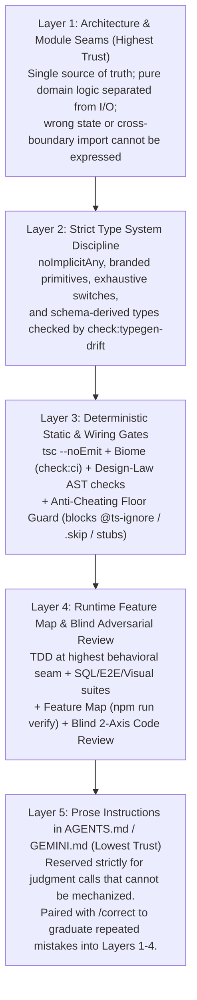
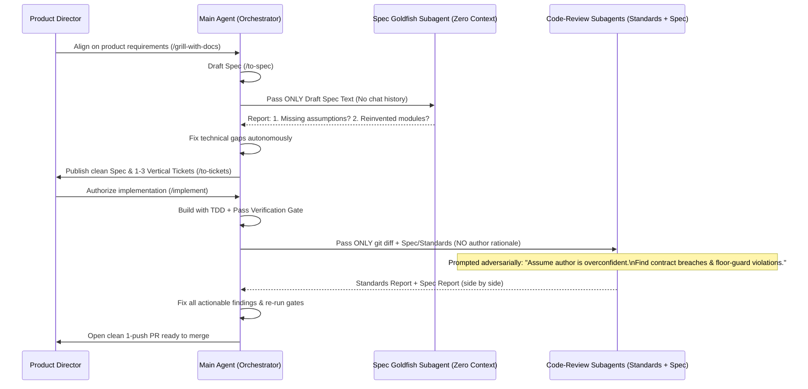

# Philosophy & The 5-Layer Trust Pyramid

## 1. The Core Problem: High-Velocity AI Coding Without Line-by-Line Human Review

When a human Product & Strategy Director (or a fast-moving product team) works with AI coding agents, the traditional quality gate—*"a human senior engineer reads every line of the pull request diff"*—does not exist.

Left to their own defaults, AI coding agents optimize for **appearing done quickly**:
* They guess unstated product requirements instead of asking.
* They write shallow, coupled workarounds or copy legacy patterns from training data.
* When a test or lint rule fails, they take the path of least resistance—adding `@ts-ignore` / `biome-ignore`, marking a flaky test `.skip`, or deleting assertions to get a green checkmark.
* When asked to review their own work, they rationalize why their implementation is safe.

Our operating system solves this by replacing **human code inspection** with **structural, adversarial, and runtime verification loops**.

---

## 2. Division of Ownership: Human Director vs. Autonomous Agent

To prevent the agent from either guessing product intent or asking the human to rubber-stamp engineering decisions, ownership is strictly partitioned:

| Domain | Owned By | Rule |
|---|---|---|
| **Product Intent, Scope, UX Feel, Copy & Business Trade-Offs** | **Human Director** | Never assumed silently. Resolved upfront via `/grill-with-docs` and live `/canvas` browser previews at `390px` & `1280px`. |
| **Paid Spend, External Billing, Destructive Actions** | **Human Director** | Every paid option carries its price and free alternative side by side (`project-init` §0); agent pauses for explicit approval. |
| **System Architecture, Module Boundaries, Database Schemas, RLS, Types & Test Seams** | **Autonomous Agent** | The agent acts as Staff Engineer/CTO. It chooses the highest behavioral test seam, enforces strict types, and never asks the human to make implementation calls. |
| **Observable Codebase Facts** | **Autonomous Agent** | If a question can be answered by reading code, running a command, or prototyping a hypothesis, the agent observes it directly—never asking the human. |

---

## 3. The 5-Layer Trust Pyramid (How Rules Are Enforced)

Written instructions in `AGENTS.md` or `GEMINI.md` are the **weakest** layer of quality control: as an agent's context window fills up during a long task, prose rules are the first thing it forgets.

Whenever an agent makes the same class of mistake twice, we use the [`/correct`](../skills/correct/SKILL.md) skill to push the rule **up into a harder mechanical layer**:

### Why External & Wiring Checks Beat Circular Unit Tests

Not all automated checks carry equal weight:
1. **Circular checks** (unit tests written by the same agent session that wrote the feature code) prove the agent agrees with itself. They are necessary, but not sufficient.
2. **Project wiring & floor-guard checks** (`design-law.wiring.test.ts`, `verify-features.wiring.test.ts`, `floor-guard`) inspect the codebase and `git diff` against fixed structural invariants owned by the project.
3. **External checks** (`tsc`, `biome check`, `axe-core` WCAG 2.2 AA, Playwright against a real production build, `lighthouse_audit`, `osv-scanner`) evaluate the real artifact against external standards the agent cannot sweet-talk.

Every production change must pass all three categories before merge.

---

## 4. Two-Stage Adversarial Verification (Defeating AI Sycophancy)

AI models are trained to be helpful and agreeable. If an author agent hands its work to a reviewer subagent along with a confident explanation (*"Here is why I built it this way and why it is safe"*), the reviewer subagent anchors on that explanation and rubber-stamps the work.

We defeat sycophancy at two critical checkpoints using **Fresh Context + Blind Contracts**:

### Checkpoint A: The "Spec Goldfish" Override (Before Publishing a Spec)
Before [`/to-spec`](../skills/to-spec/SKILL.md) publishes a specification to the issue tracker, the orchestrator spawns a fresh-context `research` subagent with **only the draft spec text** (zero chat history) to verify:
1. **Comprehension:** Can an implementer build this end-to-end without guessing unstated assumptions from the chat?
2. **Zoom-Out & Reuse:** Does the spec accidentally reinvent existing codebase modules or violate documented repo conventions?

### Checkpoint B: Pre-PR Blind Adversarial `/code-review` (Before Opening a PR)
Before opening a pull request, [`/code-review`](../skills/code-review/SKILL.md) spawns two parallel fresh-context subagents (**Standards** and **Spec**):
* **Blind Contract Input:** Each subagent receives **only** the `ARTIFACT` (`git diff <base>...HEAD`) and the `CONTRACT` (the issue spec or the repo's coding standards + Anti-Cheating Floor Guard). The author agent's summary and rationale are stripped completely.
* **Adversarial Framing:** Both subagents are instructed: *"Assume the author was overconfident. Do NOT validate or summarize. Report every standard breach, floor-guard violation, missing requirement, scope creep, or broken edge case, citing exact lines and hunks."*

---

## 5. Scientific Debugging & Optimization Discipline

When debugging a hard failure or optimizing performance/CI speed, agents must follow three binding laws (encoded in `GEMINI.md` and [`diagnosing-bugs`](../skills/diagnosing-bugs/SKILL.md)):

1. **Attack the Premise (The 2-Strike Rule):**
   When two fixes that share one causal premise fail the same gate (e.g., assuming a UI click failed due to hydration timing and adding retries twice), **stop**. Write the shared premise down and test that premise directly against the live artifact or trace before writing a third fix that assumes it.
2. **Explain the Number:**
   Before trusting, reporting, or acting on any measured number (a speedup, a CI duration, a pass count, a billing metric), find what limits it and rule out that it measured something other than the work you think (for example, VM CPU variance or per-job CI billing rounding).
3. **Measured Improvement (Dual Baselines & Decision Logs):**
   Performance and CI optimization work requires:
   * A frozen baseline measured **twice on the same green commit SHA** to bound natural variance.
   * A stated target and regression gate (speedups that drop test coverage or browser/accessibility checks are disqualified).
   * A committed decision log recording every hypothesis tested (both accepted wins and reverted experiments).
   * One commit per accepted win, and an immediate revert for any change that does not measurably help.
