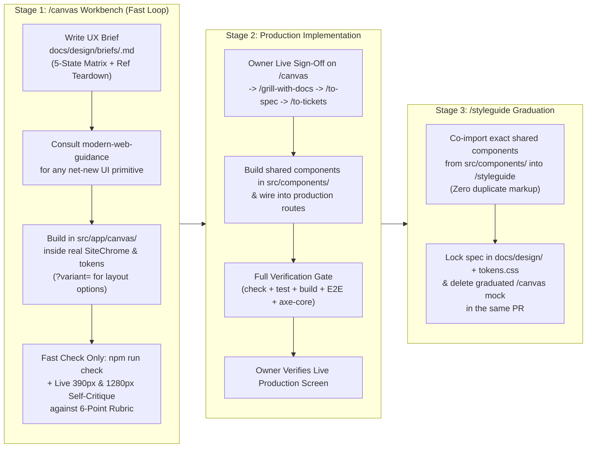

# Proportional Workflow Tiers & The 3-Tier UX Surface Gate

Running full specification and multi-subagent ceremony on a two-line copy fix wastes hours; skipping ceremony on a multi-table schema and navigation overhaul creates regressions.

Our workflow scales ceremony proportionally across **three execution tiers**, governed by a strict **3-Tier UX Surface Gate** whenever user-facing layout or composition changes.

---

## 1. Proportional Workflow Tiers

| Tier | Scope | Process | Verification & Review Gate |
|---|---|---|---|
| **Tier 1 — Fast-Track** | Docs, copy updates, single asset swaps, token/CSS tweaks, trivial non-behavioral fixes. | 1. Preview & batch visual/copy tweaks in live browser (`390px` + `1280px`) with owner first. 2. Branch (`style/*`, `content/*`, `fix/*`). 3. Edit & run fast static check (`npm run check`). | **Gate:** `npm run check` (docs-only exempt). **Review:** Self-review full diff; open 1 clean PR; squash merge. *(No subagent `code-review` or E2E tax.)* |
| **Tier 1.5 — Express Feature & Bug Fix** | Reproducible bug fixes, UI polish using existing `/styleguide` primitives, and single-behavior features touching **1–4 files** with unambiguous requirements and no new tables/auth models. | 1. Branch (`fix/*`, `feat/*`). 2. Invoke `/tdd` (`red → green → refactor`) at highest behavioral seam. 3. Pass Verification Gate. 4. Run local Blind `/code-review` against `origin/main` & fix findings. 5. Open PR → squash merge & go-live. | **Gate:** `npm run check && npm test && npm run build` (+ targeted E2E/visual if touching a flow). **Review:** Parallel 2-axis `/code-review` before opening PR. *(Skips `grill → spec → tickets` ceremony.)* |
| **Tier 2 — Standard Architecture & Multi-Surface Features** | New screens, DB schema migrations, new `/styleguide` components, cross-cutting domain features. | 1. If UI composition/shell changes, run `/canvas` on the **fast loop** (`390px` + `1280px`) until owner signs off. 2. Run `/sharpen` (if broad) → `/grill-with-docs` → `/to-spec` (with Spec Goldfish) → `/to-tickets` (**1–3 coarse vertical slices**). 3. **Stop & hand back** to owner to invoke `/implement` or `/implement-spec`. 4. Build slice + co-import into `/styleguide` + remove `/canvas` mock → Verification Gate → Pre-PR `/code-review` → PR → merge & go-live. | **Gate:** Full Verification Gate (`check:ci`, `test`, `build`, `test:sql`, `test:e2e`, `test:visual`, `npm run verify` feature map). **Review:** Spec Goldfish at spec time + 2-axis `/code-review` before PR + owner live browser sign-off on new surfaces. |

---

## 2. Coarse Vertical Ticket Slicing (Why 1–3 Slices Beat 8–10 Micro-Tickets)

When [`/to-tickets`](../skills/to-tickets/SKILL.md) breaks down a Tier 2 specification, it must slice work into **1–3 coarse vertical feature PRs**—never 6–10 horizontal micro-tickets.

### Anti-Pattern (Horizontal Micro-Slicing)
* Ticket 1: Add database migration
* Ticket 2: Add backend query helpers
* Ticket 3: Build dead UI component in `/styleguide`
* Ticket 4: Wire UI component into page A
* Ticket 5: Wire UI component into page B
* Ticket 6: Add E2E tests

**Why micro-slicing fails:** Every ticket pays the full build, test, review, PR, and CI merge tax (multiplying time and CI minutes by 6×), and "dead UI" built before real wiring almost always has to be rewritten when connected to real data.

### Our Standard (1–3 Coarse Vertical Slices)
* **Slice 1 (Foundation + Core Vertical):** Database migration + RLS/SQL tests + pure domain logic + primary route/API + unit tests.
* **Slice 2 (Complete User Surface + E2E):** Production screens using shared presentational components + entry-point wiring + Feature-Map journey (`docs/verification/features.md`) + E2E & accessibility verification.
* **Slice 3 (Styleguide Graduation & Cleanup, when introducing new UI components):** After owner verifies the live production screen, co-import the shared production components into `/styleguide`, update visual baselines, and delete the graduated `/canvas` prototype in the same PR.

---

## 3. The 3-Tier UX Surface Gate (`/canvas` → Production → `/styleguide`)

Agents must never invent unratified UI layouts directly inside production routes or dump duplicate mock markup into `/styleguide`.

### Explicit Triggers for the 3-Tier Surface Gate
Stop and invoke [`/canvas`](../skills/canvas/SKILL.md) before writing production code whenever a task:
1. Introduces a **new screen concept** or route family.
2. Modifies **site shell navigation** or adds a **control bar above an existing section body**.
3. Changes the **responsive shape or size** of an existing shared control.
4. Assembles a **material UI composition with no precedent** in `/styleguide`.

### The 6-Point Perceptual Ergonomics Rubric (`390px` & `1280px`)
Before presenting a `/canvas` prototype (or a production UI change) to the owner, the agent must inspect live rendered screenshots in `chrome-devtools-mcp` at **`390px` (mobile)** and **`1280px` (desktop)** and pass all six checks:

1. **Left-Axis Scan Alignment:** Avatars, primary titles, body lines, and inline action buttons share clean vertical left axes with zero ragged indentation across sibling rows.
2. **Right-Edge Axis Alignment:** Row timestamps, metadata, and count badges sit in a dedicated right-aligned column sharing one vertical right axis.
3. **Proportional Sizing & WCAG AA Contrast:** Controls, icons, body copy, and headings use semantic size/weight tokens and pass WCAG 2.2 AA contrast on every surface.
4. **Chrome Budget & Zero Redundancy:** Mobile `390px` stacks at most **2** top header/control bars; filter chips never duplicate parent tab counts; zero dead/hidden inputs; zero filler copy.
5. **Overlay Reflow Isolation:** Opening or closing drawers, sheets, or popovers (`position: fixed` / `absolute`, `--z-overlay`) causes **0px** width shift or reflow on the underlying page container.
6. **100% System Fidelity:** Real brand logo, real site chrome, real domain cards, realistic fixture media, and semantic tokens from `tokens.css` (zero wireframe boxes, zero hardcoded hex/px values).
