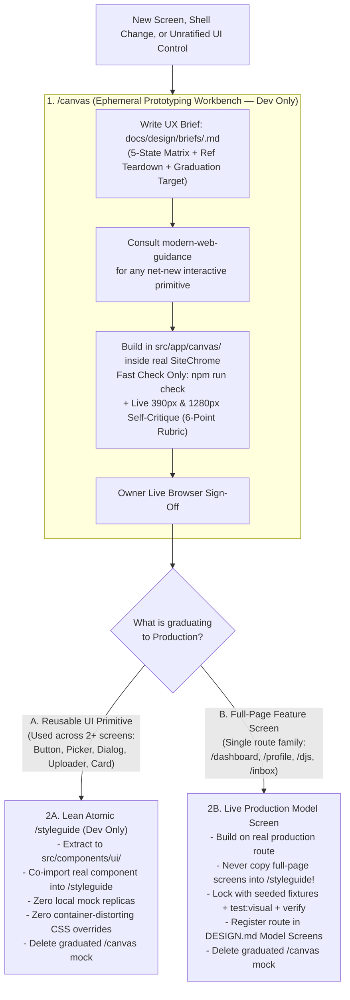

# Proportional Workflow Tiers & The 3-Surface Design Architecture

Running full specification and multi-subagent ceremony on a two-line copy fix wastes hours; skipping ceremony on a multi-table schema and navigation overhaul creates regressions.

Our workflow scales ceremony proportionally across **three execution tiers**, paired with a **3-Surface Design Architecture** (`/canvas` → Production Model Screens vs. Lean Primitive `/styleguide`) whenever user-facing layout or components change.

---

## 1. Proportional Workflow Tiers

| Tier | Scope | Process | Verification & Review Gate |
|---|---|---|---|
| **Tier 1 — Fast-Track** | Docs, copy updates, single asset swaps, token/CSS tweaks, trivial non-behavioral fixes. | 1. Preview & batch visual/copy tweaks in live browser (`390px` + `1280px`) with owner first. 2. Branch (`style/*`, `content/*`, `fix/*`). 3. Edit & run fast static check (`npm run check`). | **Gate:** `npm run check` (docs-only exempt). **Review:** Self-review full diff; open 1 clean PR; squash merge. *(No subagent `code-review` or E2E tax.)* |
| **Tier 1.5 — Express Feature & Bug Fix** | Reproducible bug fixes, UI polish using existing `/styleguide` primitives, and single-behavior features touching **1–4 files** with unambiguous requirements and no new tables/auth models. | 1. Branch (`fix/*`, `feat/*`). 2. Invoke `/tdd` (`red → green → refactor`) at highest behavioral seam. 3. Pass Verification Gate. 4. Run local Blind `/code-review` against `origin/main` & fix findings. 5. Open PR → squash merge & go-live. | **Gate:** `npm run check && npm test && npm run build` (+ targeted E2E/visual if touching a flow). **Review:** Parallel 2-axis `/code-review` before opening PR. *(Skips `grill → spec → tickets` ceremony.)* |
| **Tier 2 — Standard Architecture & Multi-Surface Features** | New screens, DB schema migrations, new `/styleguide` primitives, cross-cutting domain features. | 1. If UI composition/shell changes, run `/canvas` on the **fast loop** (`390px` + `1280px`) until owner signs off. 2. Run `/sharpen` (if broad) → `/grill-with-docs` → `/to-spec` (with Spec Goldfish) → `/to-tickets` (**1–3 coarse vertical slices**). 3. **Stop & hand back** to owner to invoke `/implement` or `/implement-spec`. 4. Build slice + delete graduated `/canvas` mock (+ co-import into `/styleguide` *only* if a new reusable primitive was created) → Verification Gate → Pre-PR `/code-review` → PR → merge & go-live. | **Gate:** Full Verification Gate (`check:ci`, `test`, `build`, `test:sql`, `test:e2e`, `test:visual`, `npm run verify` feature map). **Review:** Spec Goldfish at spec time + 2-axis `/code-review` before PR + owner live browser sign-off on new surfaces. |

---

## 2. Coarse Vertical Ticket Slicing (Why 1–3 Slices Beat 8–10 Micro-Tickets)

When [`/to-tickets`](../skills/to-tickets/SKILL.md) breaks down a Tier 2 specification, it must slice work into **1–3 coarse vertical feature PRs**—never 6–10 horizontal micro-tickets.

### Anti-Pattern (Horizontal Micro-Slicing)
* Ticket 1: Add database migration
* Ticket 2: Add backend query helpers
* Ticket 3: Build dead UI component in `/styleguide`
* Ticket 4: Wire UI component into page A
* Ticket 5: Wire UI component into page B
* Ticket 6: Add E2E tests

**Why micro-slicing fails:** Every ticket pays the full build, test, review, PR, and CI merge tax (multiplying time and CI minutes by 6×), and "dead UI" built before real wiring almost always has to be rewritten when connected to real data.

### Our Standard (1–2 Vertical Feature Slices; 3 Only When Promoting a True Shared Primitive)
* **Slice 1 (Foundation + Core Vertical):** Database migration + RLS/SQL tests + pure domain logic + primary route/API + unit tests.
* **Slice 2 (Complete User Surface + E2E + `/canvas` Retirement):** Production screens + entry-point wiring + Feature-Map journey (`docs/verification/features.md`) + E2E & `test:visual` baselines + **deletion of the graduated `/canvas` prototype** (+ co-import into `/styleguide` if a new reusable primitive was built).

---

## 3. The 3-Surface Design Architecture (Why Design Stays in the Project Repo, Split into 3 Strict Roles)

### Why Design Docs, Tokens & Catalog Stay in the Project Repo (Never a Separate Repo)
Agents rely on atomic verification (`npm run check:design`, TypeScript compiler checks, and CSS token resolution) in the same commit as feature code. Moving `tokens.css`, `DESIGN.md`, or `/styleguide` into a separate repository breaks live component imports and guarantees drift.

Instead, they live **inside the project repo**, gated so **neither `/canvas` nor `/styleguide` ever ships on the live public production site** (`if (process.env.VERCEL_ENV === "production") notFound();`).

### The Three Strict Surface Roles

### Why Full-Page Feature Screens Must NEVER Be Put Into `/styleguide`
Cramming full-page feature screens (`Dashboard`, `Discovery`, `Inbox/Messages`, `Profile`) into `/styleguide` causes three severe failures:
1. **Container & Viewport Distortion (Visual Flaws):** Full-page views expect a `1200px`–`1440px` viewport container, viewport-level `@media (max-width: 768px)` queries, and `position: sticky` headers. Stuffing them inside a nested `<StateCell>` box on `/styleguide` breaks sticky headers, prevents mobile media queries from firing, and forces agents to write thousands of lines of hacky `styleguide.module.css` overrides.
2. **Mock Drift:** Maintaining 500-line fake prop fixtures inside `/styleguide` for every page in the app guarantees that when a production page evolves, the `/styleguide` copy drifts out of sync and misleads future agents.
3. **Zero Reuse Value:** Agents consult `/styleguide` to discover **reusable building blocks** (`<Button>`, `<IconButton>`, `<Field>`, `<Section>`, `<ConfirmDialog>`, `<SaveBand>`, domain cards). An agent will never reuse a single-route page view on another screen.

### Four Hard Rules for `/styleguide` Hygiene (Enforced by `check:design`)
1. **The 2+ Screen Primitive Bar:** Only Foundations (Colors, Typography, Spacing, Radii) and reusable components consumed across **2+ screens** (`src/components/ui/*`, `src/styles/controls.css`, shared cards) belong in `/styleguide`.
2. **100% Real Imports (Zero Fake Replicas):** Every component specimen in `src/app/styleguide/` must import the real component from `src/components/`. Defining local fake/replica UI components inside `src/app/styleguide/` is forbidden.
3. **Zero Component-Internal CSS Overrides in `styleguide.module.css`:** `styleguide.module.css` may style only the catalog's own outer documentation chrome (`<Specimen>`, `<StateCell>`, token swatch grids)—never the internals of a showcased component.
4. **Dev-Only Production Gate:** Both `src/app/canvas/` and `src/app/styleguide/` must return `notFound()` in public production deployments (`VERCEL_ENV === "production"`).

---

## 4. The 6-Point Perceptual Ergonomics Rubric (`390px` & `1280px`)

Before presenting a `/canvas` prototype (or a production UI change) to the owner, the agent must inspect live rendered screenshots in `chrome-devtools-mcp` at **`390px` (mobile)** and **`1280px` (desktop)** and pass all six checks:

1. **Left-Axis Scan Alignment:** Avatars, primary titles, body lines, and inline action buttons share clean vertical left axes with zero ragged indentation across sibling rows.
2. **Right-Edge Axis Alignment:** Row timestamps, metadata, and count badges sit in a dedicated right-aligned column sharing one vertical right axis.
3. **Proportional Sizing & WCAG AA Contrast:** Controls, icons, body copy, and headings use semantic size/weight tokens and pass WCAG 2.2 AA contrast on every surface.
4. **Chrome Budget & Zero Redundancy:** Mobile `390px` stacks at most **2** top header/control bars; filter chips never duplicate parent tab counts; zero dead/hidden inputs; zero filler copy.
5. **Overlay Reflow Isolation:** Opening or closing drawers, sheets, or popovers (`position: fixed` / `absolute`, `--z-overlay`) causes **0px** width shift or reflow on the underlying page container.
6. **100% System Fidelity:** Real brand logo, real site chrome, real domain cards, realistic fixture media, and semantic tokens from `tokens.css` (zero wireframe boxes, zero hardcoded hex/px values).
